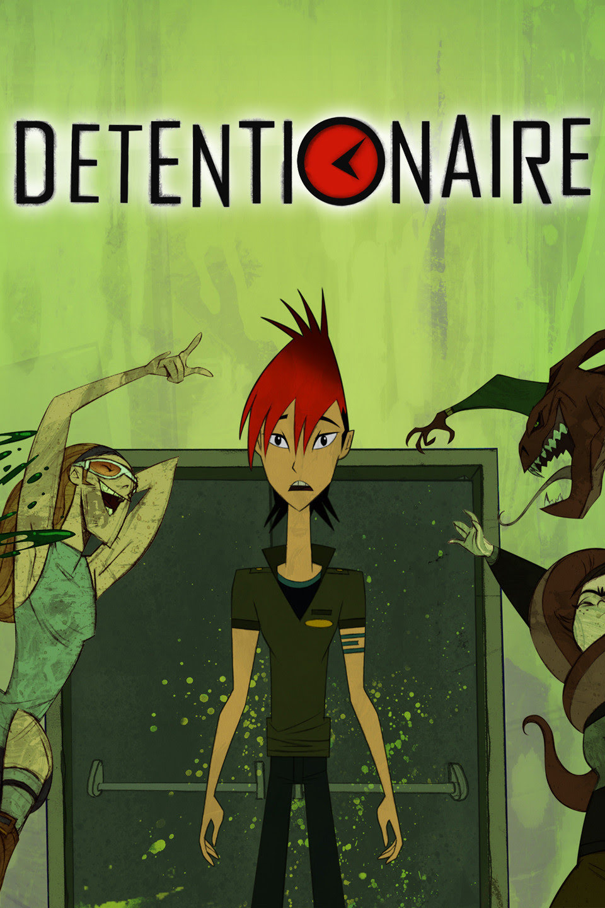

# The 5D Detective Agency

Aim and concept: The player becomes a detective investigating cyberbullying mysteries in a virtual school or city. Through exploration, collecting clues, talking to characters, and solving puzzles, the player discovers what happened and learns how to intervene using the 5Ds: Direct, Distract, Delegate, Delay, and Document. The goal is not just to solve the mystery, but to protect victims, stop harmful behavior, and become a better active bystander.

## The 5Ds as Detective Powers
Each D becomes a special ability the player can use during investigations.

### 5D	In-game ability
- **Direct** :	Intervene safely to stop harmful behavior
- **Distract**	: Redirect attention away from the victim
- **Delegate**	: Call trusted allies or adults for help
- **Delay**	: Check on and support the victim afterward
- **Document**	: Collect and preserve digital evidence

Key idea: The player has all five powers and must decide when and how to use them.

### How the Game Works
Genre: Detective adventure / mystery / puzzle-solving
1. Receive a case: A mysterious cyberbullying incident occurs.
2. Investigate: Explore the environment, interview characters, collect clues, and solve puzzles.
3. Take action: Use one or several 5D abilities to intervene.
4. Resolve the case: Protect the victim, limit further harm, and unlock the next mystery.
Game mechanics: Character customization, exploration, interactive dialogue, evidence boards, mini-games, branching decisions, XP, rewards, and unlockable cases.

Key idea: Players learn by doing, rather than answering educational quizzes.

### Example Detective Missions
Mission	Challenge	5Ds used
The Anonymous Account	Someone is receiving hurtful anonymous messages. Investigate the messages and find a safe way to help.	Document + Delegate
The Rumor Mystery	A false rumor spreads through the school group chat. Discover what happened and stop it from spreading.	Distract + Direct
The Missing Friend	A student suddenly withdraws from online groups. Investigate possible exclusion and offer support.	Delay + Delegate
Final challenge: A complex cyberbullying case where players combine several 5D abilities to protect those affected.

Learning objective: Develop cyberbullying awareness, bystander self-efficacy, decision-making, and safe intervention skills through engaging gameplay.

